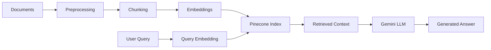

# Subject Matter Expert (SME) AI Agent: Data Science Fundamentals

This is a Retrieval-Augmented Generation (RAG) system that acts as a subject matter expert on Data Science fundamentals. It uses a data pipeline to process and index documents into a vector database, and a retrieval pipeline to answer questions using the indexed data and the Gemini LLM.

## Project Structure

```
.
├── assets.json
├── data/
├── indexing/
├── preprocessing/
└── retrieval/
```

## Setup

### Prerequisites
- Python 3.8+
- Pinecone account
- Google AI account
- Hugging Face account

### Install Dependencies

```bash
pip3 install pypdf python-docx langchain tiktoken sentence-transformers pinecone google-generativeai tqdm
```

### Configure API Keys

Create an `assets.json` file in the project root with your credentials:

```json
{
  "pinecone_api_key": "YOUR_PINECONE_KEY_HERE",
  "hf_token": "YOUR_HUGGING_FACE_TOKEN_HERE",
  "gemini_api_key": "YOUR_GEMINI_API_KEY_HERE"
}
```

## Usage

> [!IMPORTANT]
> All commands must be run from the project's root directory.

### Index Data

Place your source documents in the `data/` folder and run the indexing script. This only needs to be done once per dataset.

```bash
python3 -m indexing.index
```

### Ask a Question

Run the RAG pipeline to get an answer to the query defined in the script.

```bash
python3 -m retrieval.rag_pipeline
```

## Features

- **Document Processing**: Supports PDF and DOCX formats
- **Vector Storage**: Uses Pinecone for efficient similarity search
- **Embeddings**: Leverages Sentence Transformers for semantic understanding
- **LLM Integration**: Powered by Google's Gemini for natural language responses
- **Chunking Strategy**: Intelligent text splitting using LangChain

## Architecture



## Notes

- The indexing process only needs to be run when adding new documents or updating the dataset
- Ensure your API keys have appropriate permissions and quota
- The system uses the `sentence-transformers` library for creating embeddings
- Retrieved context is passed to Gemini to generate contextually relevant answers